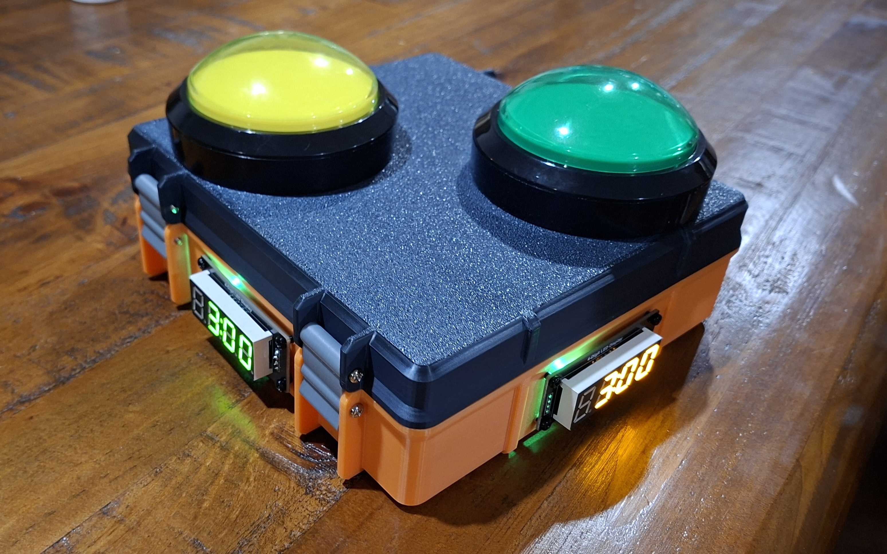
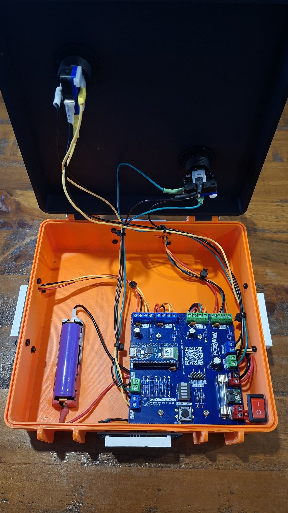
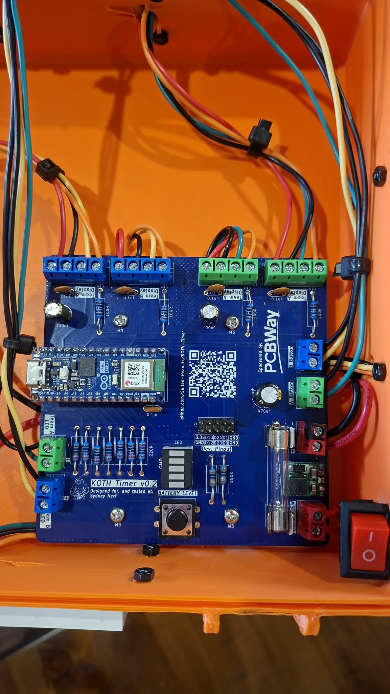

# KOTH-Timer

A DIY Arduino Nano ESP32 King of the Hill timer for Nerf and other objective-based games.

I originally built this timer for local Nerf events. It has since grown into a documented open-source build with physical team controls, four timer displays, battery monitoring, a local referee page and a tested PCB.

The timer runs entirely on the ESP32 and does not need an internet connection during a game.

## Current release

| | Current version |
|---|---|
| Firmware | **v0.4.0** |
| Tested PCB | **v0.2** |
| Admin page | **http://10.10.10.1/** |

Firmware:

```text
Firmware/KOTH_Timer_v0_4_0/KOTH_Timer_v0_4_0.ino
```

PCB files:

```text
PCB/v0.2-tested/
```

PCB v0.2 is still the current tested board. A revised PCB is being worked on to incorporate the v0.4 hardware changes directly.

### v0.4.0 hardware note

v0.4.0 changes the battery divider from the original 100 kΩ / 100 kΩ pair to:

```text
R1 = 10 kΩ
R2 = 10 kΩ
```

If you are upgrading an older timer or assembling PCB v0.2 for v0.4.0, use the 10 kΩ values before relying on the battery reading or low-battery protection.

The buzzer added in v0.4.0 is **optional**. The timer works normally without one.

See [v0.4.0 hardware changes](docs/hardware-upgrade-v0.4.0.md) for the upgrade details.

## How it works

Each team has its own countdown timer.

- Hold only Team A's button: Team A counts down.
- Hold only Team B's button: Team B counts down.
- Hold both buttons: the point is contested and neither team scores.
- Hold neither button: neither team scores.
- The first team to run its timer to zero wins.

The referee can start, pause, resume, reset and correct team time from the local web page.

v0.4.0 also allows a match to be started without a phone: hold both team buttons for 5 seconds while the timer is stopped.

## Referee page

The timer creates its own Wi-Fi network:

```text
SSID: KOTH-Timer
Password: none
```

After connecting, open:

```text
http://10.10.10.1/
```

Connection test:

```text
http://10.10.10.1/ping
```

The KOTH-Timer network has no internet access. If a phone or laptop warns about this, stay connected to the network.

Automatic browser opening was removed in v0.4.0 because it was inconsistent between devices. The admin address is now opened manually.

## v0.4.0 changes

The main changes from v0.3.1 are:

- 5-second physical match start using both team buttons
- optional active buzzer on D13
- scoring chirps, start countdown, victory sound and low-battery warning when a buzzer is fitted
- new winner animation on the TM1637 displays
- 10 kΩ / 10 kΩ battery divider and revised ADC calibration
- revised 5-segment battery gauge
- critical low-battery warning below 3.40 V
- automatic game freeze and saved-state recovery if the battery goes critical
- saved games restore paused after a battery swap or reboot
- cleaner referee-page control behaviour
- captive-portal code removed

Full details are in the [v0.4.0 release notes](docs/release-notes-v0.4.0.md).

## Optional buzzer

My build uses the [Keyestudio Active Buzzer Alarm Module for Arduino](https://www.keyestudio.com/products/keyestudio-active-buzzer-alarm-module-for-arduino).

Wiring:

```text
VCC -> 3.3 V
GND -> GND
SIG -> D13
```

With the buzzer fitted, the physical start sequence is:

```text
BEEP ... BEEP ... BEEEEEEP
                    ^
                    GO
```

The game starts at the beginning of the long beep.

If no buzzer is connected, all normal timer functions still work; the audible feedback is simply absent.

## Hardware

The current build uses:

- Arduino Nano ESP32
- single 18650 Li-ion cell and holder
- 5 V boost converter
- fuse and main power switch
- 2 illuminated arcade team buttons
- 4 TM1637 4-digit displays
- 5-segment battery indicator
- battery-check button
- 2 × 10 kΩ battery-divider resistors
- 220 Ω LED current-limiting resistors
- optional active buzzer
- prototype wiring or PCB v0.2
- enclosure

The current BOM is available in both formats:

- [BOM.csv](docs/BOM.csv)
- [BOM.xlsx](docs/BOM.xlsx)

## PCB revisions

| Revision | Status |
|---|---|
| **v0.1** | First manufactured board. Kept for reference; has known TM1637 display reliability issues. |
| **v0.2** | Manufactured, assembled and tested. Current recommended PCB. |
| **Next revision** | In development. Intended to incorporate the v0.4 resistor and buzzer changes directly. |

### Using PCB v0.2 with firmware v0.4.0

PCB v0.2 remains usable with v0.4.0.

Use 10 kΩ resistors at R1 and R2 instead of the original 100 kΩ values shown in the v0.2 design files.

If audible feedback is wanted, the easiest option on PCB v0.2 is to use the **DEV pinout**. It exposes D13, 3.3 V and GND, so the buzzer can be added without soldering directly to the Nano ESP32.

The original v0.2 KiCad and Gerber files have been left unchanged because they represent the board that was actually manufactured and tested.

## Build files and documentation

- [Build guide](docs/build-guide.md)
- [v0.4.0 hardware changes](docs/hardware-upgrade-v0.4.0.md)
- [v0.4.0 release notes](docs/release-notes-v0.4.0.md)
- [Documentation index](docs/README.md)
- [Changelog](CHANGELOG.md)

The firmware is written for the Arduino Nano ESP32 using Arduino IDE.

Keep the sketch inside a folder with the same base name:

```text
Firmware/
  KOTH_Timer_v0_4_0/
    KOTH_Timer_v0_4_0.ino
```

External libraries used by the firmware:

- WebSockets
- TM1637Display

Wi-Fi, WebServer and Preferences are supplied by the Arduino Nano ESP32 board package.

## Photos

### Finished prototype



### Inside wiring



### PCB



## PCBWay

PCB v0.2 is also available as a shared PCBWay project:

[View KOTH Timer PCB v0.2 on PCBWay](https://www.pcbway.com/project/shareproject/King_Of_The_Hill_ESP32_based_timer_1aeedfa7.html)

That page shows the original v0.2 hardware. For firmware v0.4.0, use the current BOM and the v0.4 hardware notes in this repository.

PCB manufacturing for this project has been supported by [PCBWay](https://pcbway.com/g/EGJ27l).

They have been a huge help in this project. I've been very impressed by the quality of the PCBs and by the customer service. I highly recommend anyone building this for themselves to check out PCBWay's manufacturing services.  

## Licence

MIT Licence.
